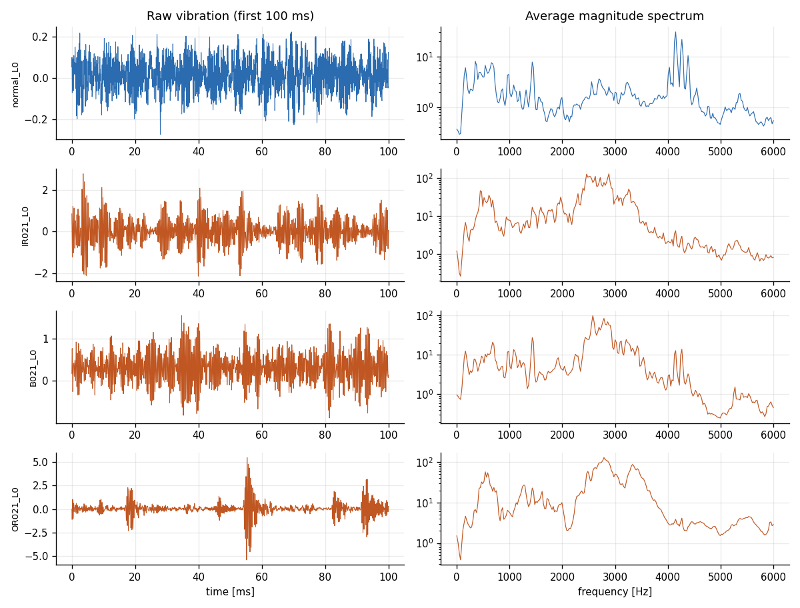
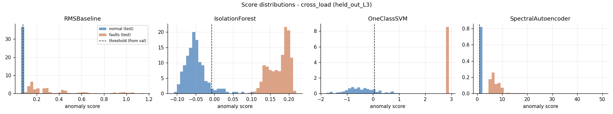
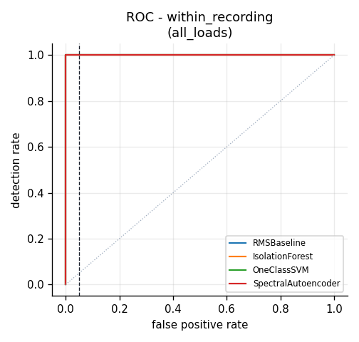

# Leakage-Aware Vibration Anomaly Detection

**Normal-only anomaly detection for bearing vibration signals — from an RMS baseline to classical machine learning and a spectral autoencoder.**

A small, reproducible experiment on the [Case Western Reserve University (CWRU) Bearing Data Center](https://engineering.case.edu/bearingdatacenter/welcome) dataset. The central question is not just *can a detector rank faulty signals above normal ones?* but *does an alarm threshold calibrated on normal data still work under an unseen motor load?*

> **Scope:** This project analyzes **mechanical bearing vibration**, not sonar echoes or distributed acoustic sensing (DAS) measurements. The transferable methods are time-series segmentation, signal processing, normal-only anomaly detection, threshold calibration, and operating-condition shift evaluation. Results must not be interpreted as sonar or DAS performance.

## Research questions

1. Can anomaly detectors trained **only on normal vibration windows** identify bearing faults?
2. Are complex ML models better than a simple **RMS amplitude baseline**?
3. What happens to false alarms when the test motor load was **not seen during training**?

## Dataset

- **Source:** CWRU Bearing Data Center (official dataset and download pages).
- **Sensor:** drive-end (DE) accelerometer.
- **Selected recordings:** 40 MATLAB (`.mat`) files: 4 normal recordings and 36 fault recordings.
- **Operating loads:** 0, 1, 2, and 3 HP.
- **Fault types:** inner-race (`IR`), ball (`B`), and outer-race (`OR`, 6 o'clock).
- **Fault diameters:** 0.007, 0.014, and 0.021 inches.
- **Sampling frequency used in the pipeline:** 48 kHz, according to the selected baseline and 48k drive-end data groups. The `.mat` loader itself does not infer sampling frequency; file-group provenance must be verified before interpreting frequency values.

The exact file IDs and configuration are in [`config.yaml`](config.yaml). Downloaded `.mat` files are not committed to Git.

## Approach

```text
CWRU continuous recordings
          |
          v
Split normal recordings by time / hold out an entire load
          |
          v
Windowing (2048 samples; gap between time splits)
          |
          +--> Time & frequency features --> RMS baseline / Isolation Forest / One-Class SVM
          |
          +--> 256-bin pooled log FFT spectrum --> PyTorch spectral autoencoder
          |
          v
Normal-validation scores --> fixed 95th-percentile alarm threshold
          |
          v
Unseen normal + fault test windows --> ROC-AUC, detection rate, test FPR
```

### Signal processing

- **Window length:** 2,048 samples (~42.7 ms at 48 kHz).
- **Training stride:** 1,024 samples (overlap confined to the training portion).
- **Validation/test stride:** 2,048 samples (non-overlapping windows).
- **Time-domain features:** mean, standard deviation, RMS, peak amplitude, peak-to-peak amplitude, crest factor, skewness, kurtosis, impulse factor, and shape factor.
- **Frequency-domain features:** Hann-windowed FFT, log energy across 16 frequency bands, total log power, spectral centroid, and spectral entropy.
- **Autoencoder input:** pooled 256-bin log-magnitude spectrum.

### Models

| Detector | Input | Anomaly score |
|---|---|---|
| **RMS baseline** | RMS feature only | RMS amplitude (no learned model) |
| **Isolation Forest** | Time + frequency features | Negative `decision_function` |
| **One-Class SVM** (RBF) | Time + frequency features | Negative `decision_function` |
| **Spectral autoencoder** (PyTorch) | Pooled log spectrum | Mean squared reconstruction error |

Isolation Forest and One-Class SVM each use `StandardScaler` fitted **only on normal training data**. The autoencoder (256 → 64 → 16 → 64 → 256) uses a training-only scaler and early stopping on *normal validation* reconstruction loss. Fault recordings are used **only for evaluation**. RMS is included as a no-training reference point.

### Evaluation protocols

| Protocol | Training and validation | Normal test data | Fault test data |
|---|---|---|---|
| `within_recording` | Earlier segments of each normal recording, separated by gaps | Later segments of the same normal recordings | Fault recordings from all selected loads |
| `cross_load` | Normal recordings from three motor loads | The **entire** normal recording from the fourth, held-out load | Fault recordings from that same held-out load |

The 95th percentile of **normal validation** anomaly scores sets the alarm threshold (target validation FPR: **5%**). It is then kept fixed for testing. This is a *target*, not a guaranteed test FPR. Scores are also evaluated by **ROC-AUC**, which does *not* depend on the fixed threshold.

The experiment repeats the model runs with seeds `0, 1, 2`. For `cross_load`, the reported mean and spread pool **four held-out-load folds and three seeds**. Because folds share much of the training data, these 12 values must **not** be treated as 12 independent experiments.

## Results

The numbers below come from the **full CWRU run (three seeds)** shared by the project author. ROC-AUC values are displayed to three decimals; `1.000` means *rounded to three decimals*, not a claim of universal perfect performance. Detection rate is window-level fault recall under the validation-selected threshold.

### Familiar conditions: `within_recording`

| Model | ROC-AUC | Test FPR (target 5%) | Fault detection rate |
|---|---:|---:|---:|
| **RMS baseline** | 1.000 | 4.9% | 100% |
| Isolation Forest | 1.000 | 3.9% | 100% |
| One-Class SVM | 1.000 | 9.9% | 100% |
| Spectral autoencoder | 1.000 | 5.3% | 100% |

### Unseen operating condition: `cross_load`

| Model | ROC-AUC | Mean test FPR (target 5%) | Fault detection rate |
|---|---:|---:|---:|
| **RMS baseline** | 1.000 | **25.1%** | 100% |
| Isolation Forest | 1.000 | 28.7% | 100% |
| One-Class SVM | 1.000 | 42.4% | 100% |
| Spectral autoencoder | 1.000 | 87.7% | 100% |

**Critical per-load result:** When **load L0** is held out, **all four detectors produce 100% test FPR**: every normal test window triggers an alarm, even though their ROC-AUC values are near 1.0. At loads L1–L3, the RMS baseline's test FPR is approximately **0.4%, 0%, and 0%**, respectively. These large differences show why reporting only an aggregate AUC or averaged FPR is insufficient.

The full run writes [`results/summary.md`](results/summary.md), [`results/metrics_all_runs.csv`](results/metrics_all_runs.csv), and [`results/detection_per_fault.csv`](results/detection_per_fault.csv).

### Figures



*Examples of normal and faulty vibration in the time and frequency domains.*



*Score distributions and the validation-calibrated decision threshold: score separation can look excellent while a threshold produces excessive false alarms.*



*ROC curves measure ranking quality, not the false-alarm rate of the deployed threshold.*

> Figures are generated by the script. If you are viewing the README before running the experiment, these image links may not display until the figures exist locally or are committed.

## Key findings

1. **An RMS-only baseline matches the ML models' rounded ROC-AUC and detection rate on these selected signals**, and has the lowest **average** cross-load test FPR. This suggests that vibration amplitude may already explain much of the apparently easy fault separation.
2. **Excellent ROC-AUC does not imply reliable alarms.** A fixed threshold calibrated on normal data from other loads can label a large fraction of healthy windows as faults under changed conditions.
3. **Deep learning is not automatically better.** Here the spectral autoencoder has particularly high cross-load false-alarm rates, despite nearly perfect ranking performance.
4. **Load L0 is a failure case for all detectors.** It warrants further analysis of load-specific signal amplitude, recording conditions, and threshold transfer; the experiment does not establish a single definitive cause.

## Limitations

- **Few independent normal recordings:** each load contributes one normal baseline recording; temporally separated windows from a recording remain statistically related. The `within_recording` setup is therefore relatively easy. Holding out a load is a stronger shift test, but not a substitute for independent machine or acquisition-session validation.
- **Strong amplitude contrast:** many selected faults have substantially higher RMS than normal recordings. High AUC alone does not demonstrate that a model learned sophisticated fault dynamics.
- **Laboratory benchmark:** seeded faults and controlled operating conditions may not resemble field deployments. The same results should not be expected for new machines, ambient conditions, sonar, or DAS.
- **Averaging obscures failures:** load L0 produces 100% FPR across all models, despite better performance on other loads.
- **Limited calibration and tuning:** the threshold is set on normal validation data, with fixed model hyperparameters; no claim of statistically precise 5% FPR control under distribution shift.
- **Window-level evaluation:** many windows come from a small number of continuous recordings. Results are not independent-event or independent-machine accuracy estimates.
- **Sampling-rate metadata:** file identities have been selected from the intended CWRU groups, but the code does not read per-file sampling-rate metadata from `.mat`; correct provenance is required.

## Reproduce

**Requirements:** Python 3.10+, Windows/macOS/Linux, CPU; no GPU required. PyTorch is used for the optional autoencoder.

```bash
python -m venv .venv
# Activate the virtual environment:
# Windows PowerShell: .\.venv\Scripts\Activate.ps1
# Linux / macOS: source .venv/bin/activate
python -m pip install -r requirements.txt

python -m pytest tests/ -v
python scripts/run_experiment.py --synthetic  # smoke test: NOT research results
python scripts/download_data.py               # fetch selected CWRU .mat files
python scripts/run_experiment.py --quick       # one seed, real recordings
python scripts/run_experiment.py               # full, three-seed experiment
```

The pipeline uses [`config.yaml`](config.yaml) to define selected recordings, features, splits, detector settings, seeds, and output locations. Downloaded recordings are stored under `data/raw/` and ignored by Git. If an official download fails, use the [CWRU download page](https://engineering.case.edu/bearingdatacenter/download-data-file) and save the corresponding numbered `.mat` file to `data/raw/`.

## Repository structure

```text
config.yaml                 Reproducible experiment settings
scripts/download_data.py    CWRU .mat file downloader
scripts/run_experiment.py   End-to-end evaluation and report generation
src/data.py                 Load continuous recordings
src/splits.py               Leakage-aware splits and windowing
src/features.py             Time/frequency signal features
src/models.py               RMS, Isolation Forest, One-Class SVM, autoencoder
src/evaluate.py             ROC-AUC, threshold, false alarms, detection
src/plots.py                Diagnostic figures
src/synthetic.py            Synthetic smoke-test signals
tests/test_pipeline.py      Unit tests
results/                    Generated reports and figures
data/raw/                   Downloaded CWRU files (not committed)
```

## References

- Case Western Reserve University, [Bearing Data Center](https://engineering.case.edu/bearingdatacenter/welcome) and [48k Drive End Bearing Fault Data](https://engineering.case.edu/bearingdatacenter/48k-drive-end-bearing-fault-data).
- Smith, W. A., & Randall, R. B. (2015). *Rolling element bearing diagnostics using the Case Western Reserve University data: A benchmark study*. Mechanical Systems and Signal Processing, 64–65, 100–131.
- Liu, F. T., Ting, K. M., & Zhou, Z.-H. (2008). *Isolation Forest*. IEEE International Conference on Data Mining.
- Schölkopf, B., et al. (2001). *Estimating the support of a high-dimensional distribution*. Neural Computation, 13(7).

## Author

**Abdulkarem Shahen** — M2 Mechatronics, Machine Vision and Artificial Intelligence, Université d'Évry Paris-Saclay.
